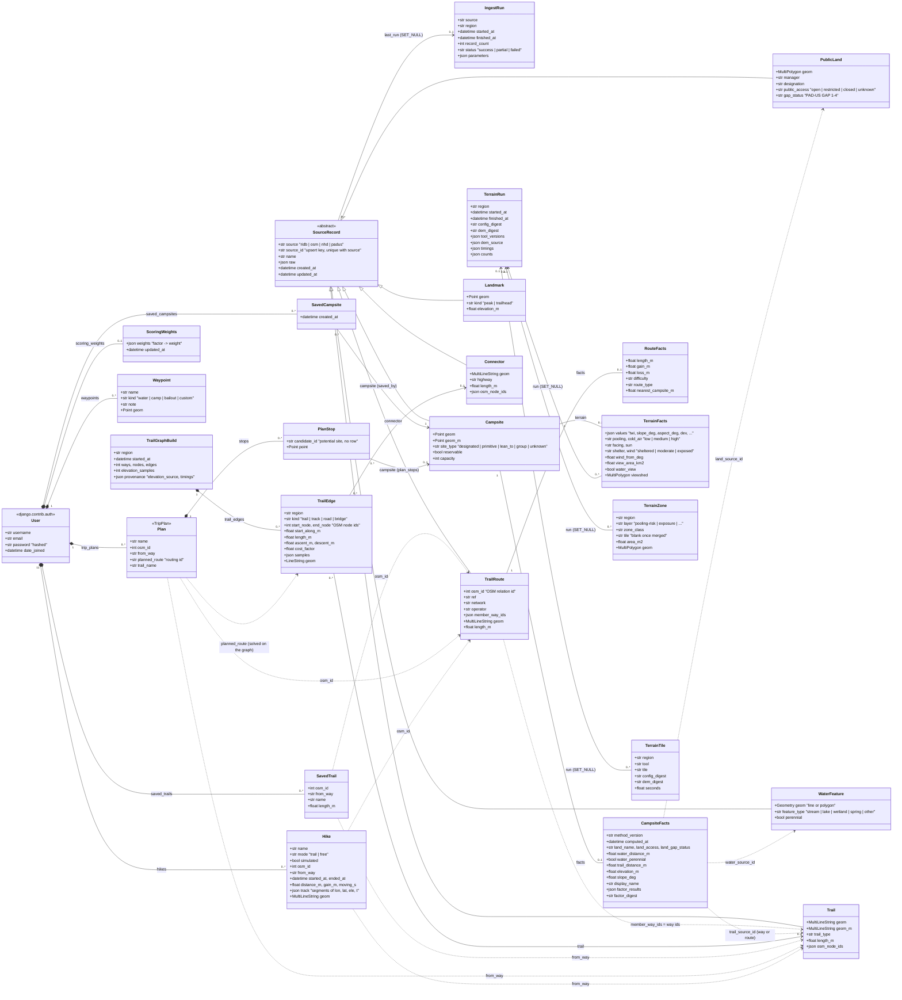

# Class diagram: the current data model (TM05-150)

This is every Django model CampSite stores, with its key fields and relationships. It was
read from the code on 2026-11-03: `backend/*/models.py`, after TM05-149.

- **Source.** The Mermaid block below is the source. GitHub renders it in place.
- **Image.** [`class-diagram.svg`](class-diagram.svg) is the same diagram, rendered with
  mermaid-cli (see [Re-rendering](#re-rendering)).
- **Visual Paradigm.** The course's version is redrawn from this one and attached to
  TM05-150 in Jira.

**How to read it.**

- **Fields.** Each class lists its key fields, not every column. The rest are in the model
  files named in the [table](#models-by-app).
- **Geometry.** `geom` is always EPSG:4326. `geom_m` is the same geometry in EPSG:5070
  metres, a column PostGIS generates (`geodata.models.metric_geom`).
- **Solid lines** are database foreign keys, with their cardinality and the
  `related_name`.
- **Dotted lines** are references by a stable source id, not by row: `osm_id`,
  `from_way`, `planned_route` and `*_source_id`.
  - These survive a re-ingest, which replaces rows.
  - The database does not enforce them.
- **`<<abstract>>`** `SourceRecord` has no table. Its seven subclasses each get its fields.
- **User** is Django's `auth.User` (`settings.AUTH_USER_MODEL`).
- **Deleting a user cascades** to everything they own (`tests/test_accounts_delete.py`).



## Models by app

The diagram shows two models under shorter names. `Plan` is `planning.TripPlan`, whose
nights are `planning.PlanStop`. `User` is `django.contrib.auth.models.User`.

| App | Model | What it is | File |
|---|---|---|---|
| geodata | `SourceRecord` (abstract) | Shared fields and the `(source, source_id)` upsert key of every ingested row | `backend/geodata/models.py` |
| geodata | `Campsite` | A campsite: a point (RIDB, OSM) | 〃 |
| geodata | `Trail` | One OSM way, with its ordered node ids | 〃 |
| geodata | `TrailRoute` | A named hiking route: an OSM `route=hiking` relation over ways | 〃 |
| geodata | `Landmark` | A peak or a trailhead | 〃 |
| geodata | `Connector` | A road or sidewalk the routing graph may walk between trails | 〃 |
| geodata | `WaterFeature` | NHD flowlines and waterbodies | 〃 |
| geodata | `PublicLand` | PAD-US land units: manager, access, GAP status | 〃 |
| geodata | `IngestRun` | Provenance of one adapter run | 〃 |
| enrichment | `CampsiteFacts` | Derived per-site facts: land, water, trail, slope, stored factor results | `backend/enrichment/models.py` |
| enrichment | `RouteFacts` | Derived per-route facts for the Discover filters | 〃 |
| terrain | `TerrainRun` | Provenance of one `make terrain` | `backend/terrain/models.py` |
| terrain | `TerrainFacts` | Per-site terrain: pooling, facing, shelter, cold air, wind, viewshed | 〃 |
| terrain | `TerrainZone` | Classified polygons (pooling risk, exposure) | 〃 |
| terrain | `TerrainTile` | One finished tile of one tool, for resuming | 〃 |
| routing | `TrailGraphBuild` | One routing graph build: counts, provenance, timings | `backend/routing/models.py` |
| routing | `TrailEdge` | One graph edge: a stretch of a way between junctions, with its climb | 〃 |
| accounts | `SavedCampsite` | A user's bookmarked campsite | `backend/accounts/models.py` |
| accounts | `ScoringWeights` | A user's own factor weights | 〃 |
| planning | `Waypoint` | A point the user marked | `backend/planning/models.py` |
| planning | `TripPlan` ("Plan") | An overnight plan along one trail or planned route | 〃 |
| planning | `PlanStop` | One night of a plan: a campsite or a potential site | 〃 |
| planning | `SavedTrail` | A trail the user saved | 〃 |
| planning | `Hike` | A recorded hike: its track and numbers | 〃 |
| analysis | `AnalysisResult` | The on-demand analysis cache (weather, 3DEP answers), keyed by a hash | `backend/analysis/models.py` |

**Not drawn.** `AnalysisResult` has no relationships: its rows are keyed by a hash of
(analysis, version, geometry, window, params), so it is left out of the diagram. The
`health` app has no models.

## Models from the old diagram that are gone

The original project diagram, from the proposal, had three models that CampSite does not
have: `Booking`, `Payment` and `Outfitter`.

- **No code for them exists.** Nothing in `backend/`, the migrations or the git history
  defines or mentions them (checked with `git log --all -S` on 2026-11-03), so there was
  nothing to delete.
- **They left with the scope.** CampSite finds and scores backcountry sites (CLAUDE.md,
  "The project"). Reservations stay with the source: `Campsite.reservable` records
  whether RIDB says a site can be booked, and the app links out rather than taking
  bookings or payments. No outfitter listings were ever ingested.
- **What took their place.** The user-side classes are now the saved items
  (`SavedCampsite`, `SavedTrail`, `ScoringWeights`) and the planning models
  (`Waypoint`, `TripPlan`/`PlanStop`, `Hike`).

## Re-rendering

When a model changes, update the Mermaid block above, then regenerate the image:

```
npx -y @mermaid-js/mermaid-cli@11.4.2 -i docs/class-diagram.md -o docs/class-diagram.svg
```

mermaid-cli renders each Mermaid block in a Markdown file. For a single block, the output
is `class-diagram-1.svg`; rename it to `class-diagram.svg`.
